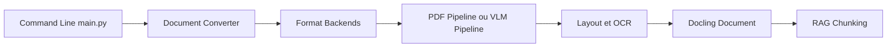

# docling-project/docling

> Converts PDF, Office, images and audio into a structured document, to feed RAG or AI pipelines.

## The problem
Office documents and PDFs lose structure and tables when fed as-is to a model.

## What it actually does
README identical to that of `DS4SD/docling`: parsing of many formats, `DoclingDocument` representation, Markdown, HTML and JSON export, OCR, vision models, audio through speech recognition, MCP server and docling-serve. The code shows a CLI or Python API, a format backend, a pipeline (PDF, VLM, ASR, video), AI steps (layout, OCR, tables, reading order) then export or chunking.

## How it is wired


## Trying it
```bash
pip install docling
docling https://arxiv.org/pdf/2206.01062
docling --pipeline vlm --vlm-model granite_docling https://arxiv.org/pdf/2206.01062
```

## Cost and gotchas
Python 3.10 minimum. Hardware requirements of the models are not documented. Anomaly: apparent duplicate of `DS4SD/docling` (same creation date, identical README, different star counts); the `docling-project` organization seems to be the current repository, not verified here.

## What it is not
It is not an LLM or a hosted service. "Coming soon" features are not delivered.

## Alternatives
No alternative named in the README.

## For you
Adopt: same ingestion building block; keep only one of the two repositories in the catalog, probably this one.
