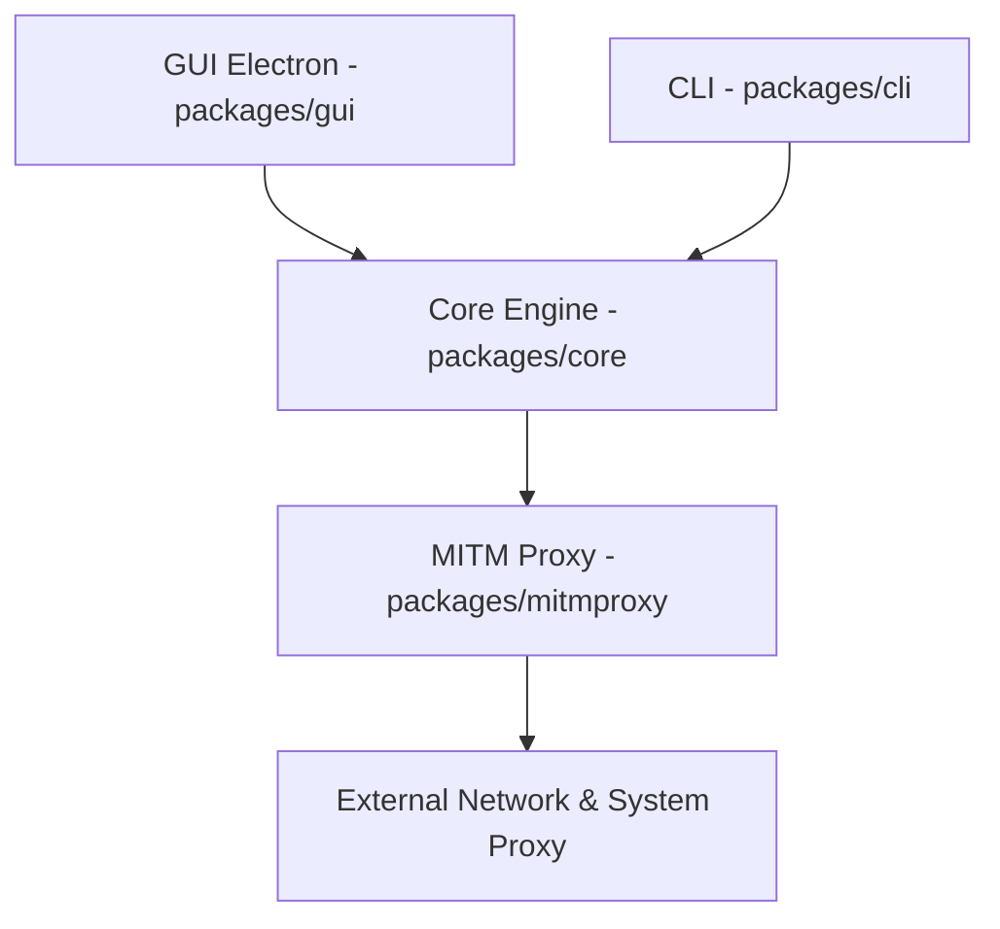

# docmirror/dev-sidecar

> Desktop application that redirects developers' HTTPS traffic to accelerators, mainly for GitHub.

## The problem
Reaching GitHub, npm, Stack Overflow and other services reliably and quickly from networks where they are slow or unreachable.

## What it actually does
Local proxy that changes the system proxy at startup. It picks the best IP through DNS resolution and a speed test, intercepts requests according to rules (redirect, proxy, drop, cache) and can modify the SNI. It offers an npm and git proxy. Three modes: safe (no interception or certificate), default (interception, remote config) and enhanced. The interface is in Chinese.

## How it is wired


## Trying it
```bash
git clone https://github.com/docmirror/dev-sidecar
cd dev-sidecar
pnpm install
cd packages/gui
npm run electron
```

## Cost and gotchas
Free. The default mode requires installing a locally generated root certificate; the README states that no data is collected, but warns against using an unknown remote configuration. A hard shutdown can leave the system proxy active and cut off network access.

## What it is not
Not a VPN, and it is incompatible with other local proxies. The README states that its purpose is direct access to GitHub: useless if you already have another way in. Bypassing network blocks may be legally regulated depending on the country.

## Alternatives
- Watt Toolkit (formerly Steam++): cited as compatible in hosts mode.
- fgit-go: clone acceleration tool cited in the README.

## For you
Ignore: niche need (access to GitHub from certain networks), a root certificate to install and documentation in Chinese; without that specific need, the risk outweighs the benefit.
