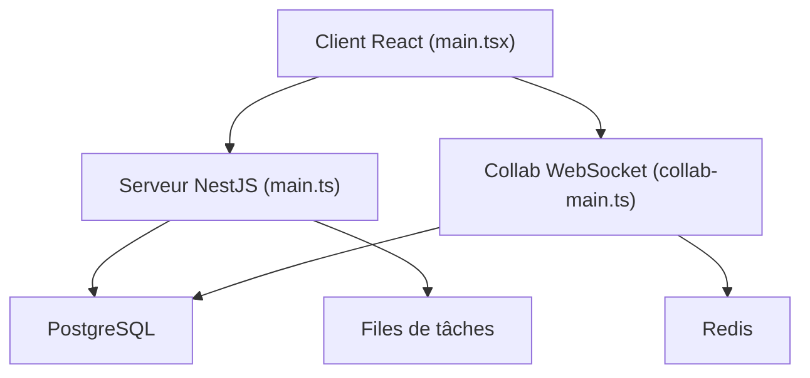

# docmost/docmost

> Open source, self-hostable collaborative wiki and documentation, for teams wanting a Confluence alternative.

## The problem
Teams need a real-time collaborative wiki that they host themselves.

## What it actually does
Space and page hierarchy with real-time collaborative editing (Yjs), diagrams (Draw.io, Excalidraw, Mermaid), permissions, groups, comments, history, search, attachments. React/Vite client, NestJS server, PostgreSQL, Redis. Local, S3 or Azure storage. Enterprise code (AI, SSO, audit, Bases) is isolated under `ee`.

## How it is wired

## Trying it
Command not documented in the README (it points to the online documentation). The repository provides a `Dockerfile` and `docker-compose.yml`.

## Cost and gotchas
Docker, PostgreSQL and Redis to manage. Enterprise features are reserved for the paid edition.

## What it is not
Not entirely free: SSO, audit, AI and Bases belong to the enterprise edition. AGPL-3.0: obligations apply if you run a modified version as a network service.

## Alternatives
No alternative named in the README.

## For you
Watch: useful for self-hosted internal docs, but the AGPL and paid features weigh in depending on usage.
