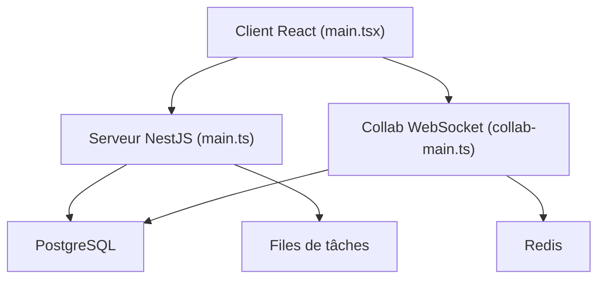

# docmost/docmost

> Wiki et documentation collaboratifs open source, auto-hébergeable, pour équipes qui veulent une alternative à Confluence.

## Le problème
Les équipes ont besoin d'un wiki collaboratif en temps réel qu'elles hébergent elles-mêmes.

## Ce que ça fait vraiment
Hiérarchie espace, page avec édition collaborative temps réel (Yjs), diagrammes (Draw.io, Excalidraw, Mermaid), permissions, groupes, commentaires, historique, recherche, pièces jointes. Client React/Vite, serveur NestJS, PostgreSQL, Redis. Stockage local, S3 ou Azure. Le code entreprise (IA, SSO, audit, Bases) est isolé sous `ee`.

## Comment c'est branché

## Essayer
Commande non documentée dans le README (renvoie à la documentation en ligne). Le dépôt fournit `Dockerfile` et `docker-compose.yml`.

## Coût et pièges
Docker, PostgreSQL et Redis à gérer. Fonctions entreprise réservées à l'édition payante.

## Ce que ce n'est pas
Pas entièrement gratuit : SSO, audit, IA et Bases relèvent de l'édition entreprise. AGPL-3.0 : obligations en cas de service réseau modifié.

## Alternatives
Aucune alternative nommée dans le README.

## Pour toi
Surveiller : utile pour une doc interne auto-hébergée, mais l'AGPL et les fonctions payantes pèsent selon l'usage.

