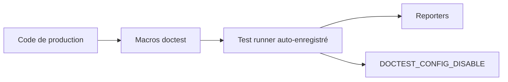

# doctest/doctest

> A single-header C++ testing framework, fast to compile, for anyone testing C++ code.

## The problem
C++ testing frameworks slow down compilation and force separate test files.

## What it actually does
It lets you write tests directly in production code, with self-registering tests. It aims for low compile times, no warnings even at the strict levels of MSVC, GCC and Clang, and is thread-safe. `DOCTEST_CONFIG_DISABLE` removes all test code from the binary. It is modeled on Catch.

## How it is wired
Simplified diagram based on the fiche, no diagram provided.

## Trying it
The README contains no command: it points to the documentation (tutorial, assertion macros, configuration).

## Cost and gotchas
Free, portable C++11 (tag 1.2.9 for C++98). Mixing tests and production code requires build discipline.

## What it is not
Not a Python or AI testing tool. Not a complete replacement for googletest on every feature.

## Alternatives
- Catch, Boost.Test, googletest, UnitTest++, cpputest: cited as competitors.

## For you
Ignore: C++-specific; a Python data or AI profile gets nothing out of it.
