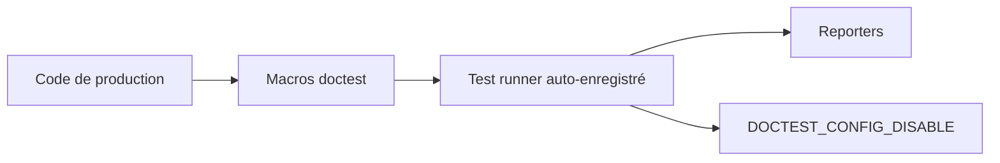

# doctest/doctest

> Un framework de tests C++ à en-tête unique, rapide à compiler, pour qui teste du code C++.

## Le problème
Les frameworks de test C++ alourdissent la compilation et obligent à des fichiers de test séparés.

## Ce que ça fait vraiment
Il permet d'écrire des tests directement dans le code de production, avec des tests auto-enregistrés. Il vise de faibles temps de compilation, aucun avertissement même aux niveaux stricts de MSVC, GCC et Clang, et reste thread-safe. `DOCTEST_CONFIG_DISABLE` retire tout le code de test du binaire. Il est modélisé sur Catch.

## Comment c'est branché
Schéma simplifié d'après la fiche, sans diagramme fourni.

## Essayer
Le README ne contient pas de commande : il renvoie à la documentation (tutoriel, macros d'assertion, configuration).

## Coût et pièges
Gratuit, C++11 portable (tag 1.2.9 pour C++98). Mêler tests et production demande une discipline de build.

## Ce que ce n'est pas
Pas un outil de test Python ni d'IA. Pas un remplaçant complet de googletest sur toutes les fonctions.

## Alternatives
- Catch, Boost.Test, googletest, UnitTest++, cpputest : cités comme concurrents.

## Pour toi
À ignorer : spécifique au C++ ; un profil data ou IA en Python n'y trouve pas son compte.

