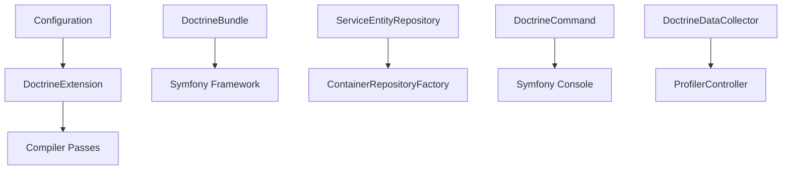

# doctrine/DoctrineBundle

> The bundle that plugs the Doctrine ORM and DBAL into the Symfony PHP framework, for PHP developers.

## The problem
Without it, you have to wire Doctrine connections, entity managers and repositories into the Symfony service container by hand.

## What it actually does
It reads the configuration (XML, YAML, attributes) and registers connections, entity managers and repositories as services. It adds console commands, event listeners via attributes, DBAL middlewares (debug, idle connections), metadata cache warm-up and a collector for the Symfony profiler.

## How it is wired


## Trying it
```bash
# Aucune commande d'installation dans le README : la documentation est sur symfony.com
# (source dans le dossier docs/ du dépôt).
```

## Cost and gotchas
Free, no key or account. You need a Symfony project and a database; the bundle is useless outside that ecosystem.

## What it is not
It is not the ORM itself: Doctrine ORM and DBAL are separate libraries, the bundle only does the linking. It cannot be used outside PHP and Symfony. The README documents no installation.

## Alternatives
No alternative named in the README.

## For you
Ignore: it is PHP/Symfony plumbing unrelated to data, AI or MLOps work, unless you maintain a Symfony application.
