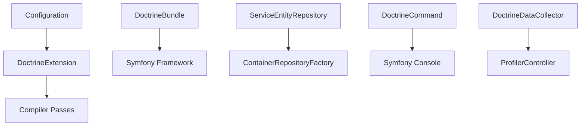

# doctrine/DoctrineBundle

> Le bundle qui branche l'ORM et le DBAL Doctrine dans le framework PHP Symfony, pour développeurs PHP.

## Le problème
Sans lui, il faut câbler à la main les connexions, les entity managers et les dépôts Doctrine dans le conteneur de services Symfony.

## Ce que ça fait vraiment
Il lit la configuration (XML, YAML, attributs) et enregistre connexions, entity managers et dépôts comme services. Il ajoute des commandes console, des écouteurs d'événements via attributs, des middlewares DBAL (debug, connexions inactives), un préchauffage du cache de métadonnées et un collecteur pour le profiler Symfony.

## Comment c'est branché


## Essayer
```bash
# Aucune commande d'installation dans le README : la documentation est sur symfony.com
# (source dans le dossier docs/ du dépôt).
```

## Coût et pièges
Gratuit, sans clé ni compte. Il faut un projet Symfony et une base de données ; le bundle est inutile hors de cet écosystème.

## Ce que ce n'est pas
Ce n'est pas l'ORM lui-même : Doctrine ORM et DBAL sont des bibliothèques distinctes, le bundle ne fait que la liaison. Ce n'est pas utilisable en dehors de PHP et de Symfony. Le README ne documente aucune installation.

## Alternatives
Aucune alternative nommée dans le README.

## Pour toi
À ignorer : c'est de la plomberie PHP/Symfony sans rapport avec un travail data, IA ou MLOps, sauf si tu maintiens une application Symfony.

