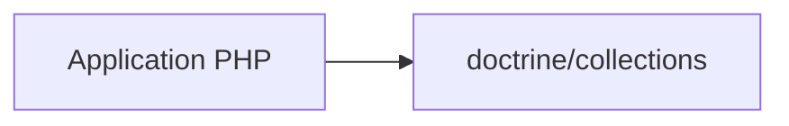

# doctrine/collections

> PHP collections abstraction library, for PHP developers.

## The problem
Not documented beyond one line: the README does not describe the problem.

## What it actually does
The README is a single sentence: "Collections Abstraction library". No function, API or example appears in it.

## How it is wired

Simplified diagram based on the fiche, no diagram provided.

## Trying it
```bash
# Aucune commande documentée dans le README.
```

## Cost and gotchas
Free. The real requirement is PHP and Composer (outside the prerequisites list), but the README does not state it.

## What it is not
Not documented here: any detail about its contents would be invented. It is not a data tool.

## Alternatives
The README names none.

## For you
Ignore: a PHP library with no documentation, unrelated to data / AI / MLOps work.
