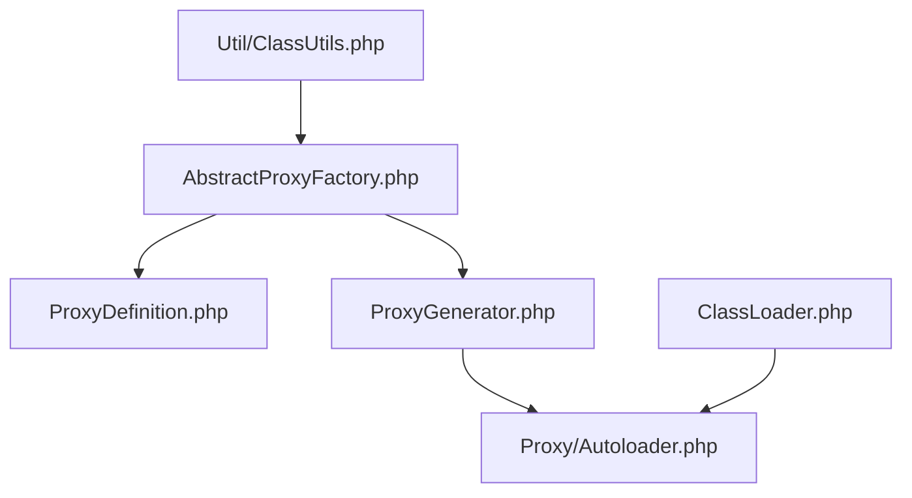

# doctrine/common

> PHP library of basic building blocks: class loader and proxy generation.

## The problem
Doctrine components need common utilities, including proxy class generation.

## What it actually does
The README is three lines long. From the code: AbstractProxyFactory builds a ProxyDefinition, ProxyGenerator writes the proxy class, the Autoloader loads it; ClassLoader, ClassUtils and Debug complete the picture.

## How it is wired

## Trying it
No command documented in the README.

## Cost and gotchas
Free. PHP is required (outside the standard prerequisites list); installation is not described. Only links to the website, documentation and downloads.

## What it is not
Not an ORM. Not documented: the README does not describe usage.

## Alternatives
No alternative named in the README.

## For you
Ignore: a PHP building block, unrelated to data / AI / MLOps work, and the README is insufficient.
