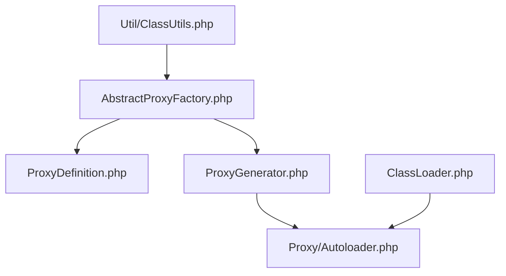

# doctrine/common

> Bibliothèque PHP de briques de base : chargeur de classes et génération de proxys.

## Le problème
Les composants Doctrine ont besoin d'utilitaires communs, dont la génération de classes proxy.

## Ce que ça fait vraiment
Le README tient en trois lignes. D'après le code : AbstractProxyFactory construit une ProxyDefinition, ProxyGenerator écrit la classe proxy, l'Autoloader la charge ; ClassLoader, ClassUtils et Debug complètent.

## Comment c'est branché

## Essayer
Aucune commande documentée dans le README.

## Coût et pièges
Gratuit. Il faut PHP (hors liste de prérequis standard) ; l'installation n'est pas décrite. Seuls des liens vers site, documentation et téléchargements.

## Ce que ce n'est pas
Pas un ORM. Pas documenté : le README ne décrit pas l'usage.

## Alternatives
Aucune alternative nommée dans le README.

## Pour toi
Ignorer : brique PHP, sans lien avec un travail data / IA / MLOps, et README insuffisant.

