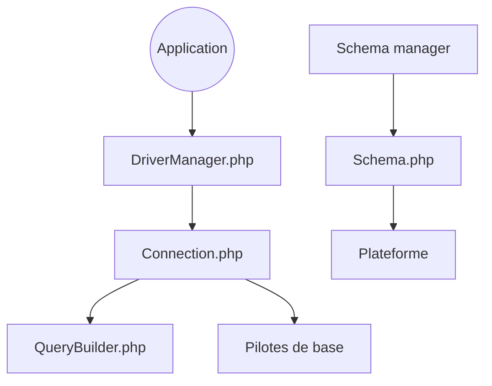

# doctrine/dbal

> Database abstraction layer for PHP, with introspection and schema management.

## The problem
Writing SQL that is portable across databases, and manipulating their schema, is tedious in PHP.

## What it actually does
The README describes almost nothing. From the code diagram: a driver manager creates the connection, a query builder builds queries, drivers send them to the database; a schema manager introspects and produces creation SQL per platform, with type conversion.

## How it is wired

## Trying it
No command documented in the README; it points to the website and documentation.

## Cost and gotchas
Free. Several branches maintained in parallel (3.10, 4.5, 4.6, 5.0-dev): pick the right version.

## What it is not
Not a full ORM: it is the layer underneath. Not related to Python or data science.

## Alternatives
No alternative named in the README.

## For you
Ignore: PHP library with no relevance for a data/AI/MLOps profile.
