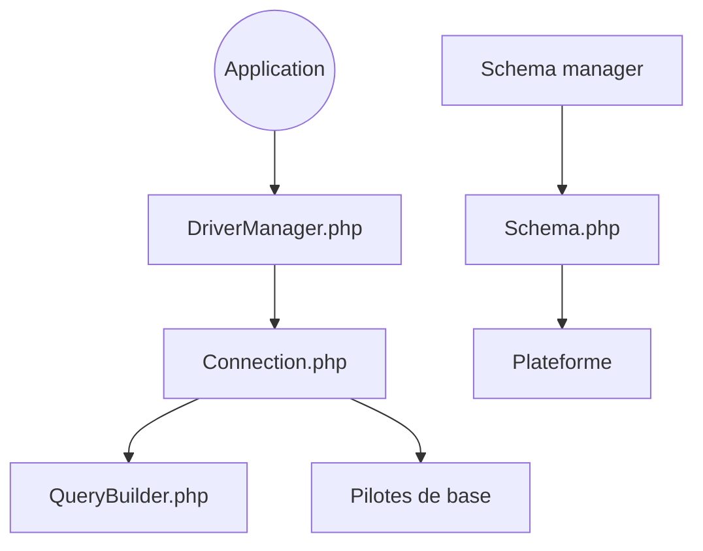

# doctrine/dbal

> Couche d'abstraction de base de données pour PHP, avec introspection et gestion de schéma.

## Le problème
Écrire du SQL portable entre bases en PHP, et manipuler leur schéma, est fastidieux.

## Ce que ça fait vraiment
Le README ne décrit presque rien. D'après le diagramme du code : un gestionnaire de pilotes crée la connexion, un query builder construit les requêtes, des pilotes les envoient à la base ; un gestionnaire de schéma introspecte et produit du SQL de création selon la plateforme, avec conversion de types.

## Comment c'est branché

## Essayer
Aucune commande documentée dans le README ; renvoi vers le site et la documentation.

## Coût et pièges
Gratuit. Plusieurs branches maintenues en parallèle (3.10, 4.5, 4.6, 5.0-dev) : choisir la bonne version.

## Ce que ce n'est pas
Pas un ORM complet : c'est la couche en dessous. Pas lié à Python ni à la data science.

## Alternatives
Aucune alternative nommée dans le README.

## Pour toi
À ignorer : bibliothèque PHP sans pertinence pour un profil data/IA/MLOps.

