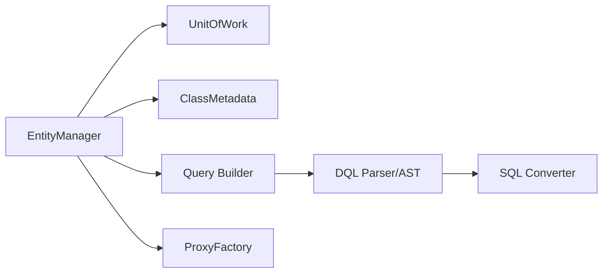

# doctrine/orm

> Object-relational mapper for PHP 8.1+ with its DQL query language, on top of DBAL.

## The problem
Persisting PHP objects in a relational database without writing all the SQL by hand.

## What it actually does
An `EntityManager` and a `UnitOfWork` track changes; mapping metadata describes the entities; DQL is parsed into an AST then converted to SQL; query and entity caches; proxies for lazy loading; console tools and SchemaTool.

## How it is wired


## Trying it
```bash
# Le README ne contient aucune commande ; il renvoie au site et à la documentation.
```

## Cost and gotchas
Free. Several branches maintained in parallel (2.20 to 4.0): pick the version according to your PHP version.

## What it is not
Not an analytical data tool: an ORM for PHP applications. 1,332 open issues.

## Alternatives
No alternative named in the README.

## For you
Ignore: a PHP ORM unrelated to your Python/AI tools; useful only if you take over a Symfony/PHP application.
