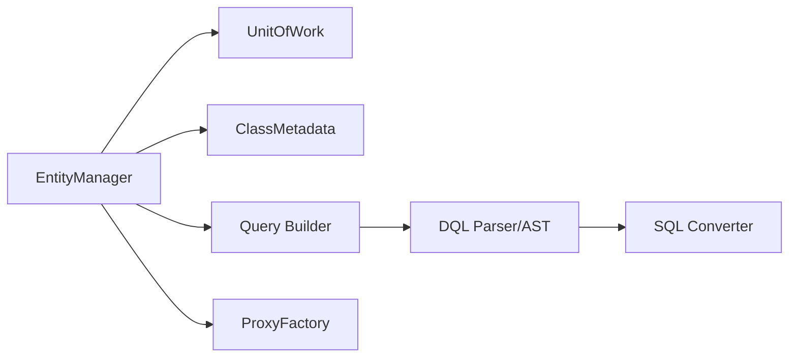

# doctrine/orm

> Mapper objet-relationnel pour PHP 8.1+ avec son langage de requêtes DQL, au-dessus de DBAL.

## Le problème
Persister des objets PHP en base relationnelle sans écrire tout le SQL à la main.

## Ce que ça fait vraiment
Un `EntityManager` et une `UnitOfWork` suivent les changements ; des métadonnées de mapping décrivent les entités ; DQL est analysé en AST puis converti en SQL ; caches de requêtes et d'entités ; proxys pour le chargement paresseux ; outils console et SchemaTool.

## Comment c'est branché


## Essayer
```bash
# Le README ne contient aucune commande ; il renvoie au site et à la documentation.
```

## Coût et pièges
Gratuit. Plusieurs branches maintenues en parallèle (2.20 à 4.0) : choisir la version selon ta version de PHP.

## Ce que ce n'est pas
Pas un outil de données analytiques : un ORM pour applications PHP. 1 332 issues ouvertes.

## Alternatives
Aucune alternative nommée dans le README.

## Pour toi
À ignorer : ORM PHP sans rapport avec tes outils Python/IA ; utile seulement si tu reprends une application Symfony/PHP.

