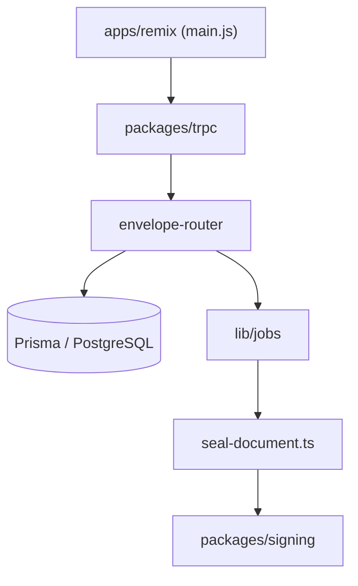

# documenso/documenso

> Open source alternative to DocuSign for signing documents, self-hostable by teams.

## The problem
E-signature tools are closed trusted third parties that you can neither inspect nor host.

## What it actually does
React Router v7 application with a Hono server: you create envelopes (documents, recipients, fields), send signing links, then seal a signed PDF with a certificate and audit log. Prisma persistence on PostgreSQL, S3 or Azure storage, local jobs, BullMQ or Inngest, tRPC API and v1 API. Enterprise features isolated in `packages/ee/`.

## How it is wired


## Trying it
```bash
cp .env.example .env
npm run dx
npm run dev
```

## Cost and gotchas
Node 24 or later, PostgreSQL, Docker recommended. Stripe, S3 and SMTP depending on usage. The Enterprise plan is paid.

## What it is not
Not a simple module: it is a complete platform. The AGPL requires you to publish modifications served over a network.

## Alternatives
DocuSign is cited as the reference the tool replaces.

## For you
Worth watching: outside the data/AI core, but useful if you need to sign documents internally without a SaaS; mind the AGPL.
