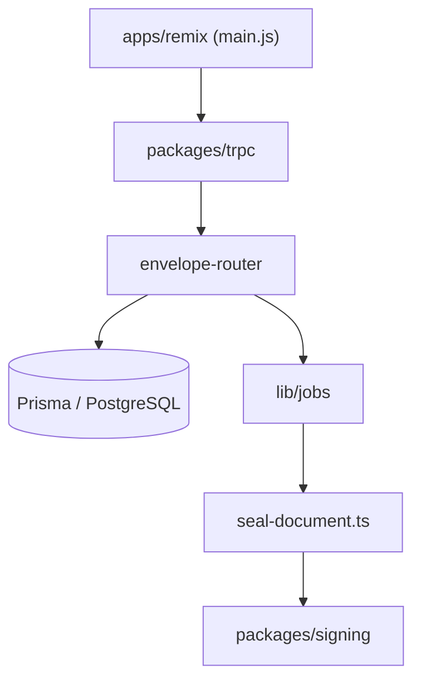

# documenso/documenso

> Alternative open source à DocuSign pour signer des documents, auto-hébergeable par les équipes.

## Le problème
Les outils de signature électronique sont des tiers de confiance fermés, que l'on ne peut ni inspecter ni héberger.

## Ce que ça fait vraiment
Application React Router v7 avec serveur Hono : on crée des enveloppes (documents, destinataires, champs), on envoie des liens de signature, puis on scelle un PDF signé avec certificat et journal d'audit. Persistance Prisma sur PostgreSQL, stockage S3 ou Azure, jobs locaux, BullMQ ou Inngest, API tRPC et API v1. Fonctions entreprise isolées dans `packages/ee/`.

## Comment c'est branché


## Essayer
```bash
cp .env.example .env
npm run dx
npm run dev
```

## Coût et pièges
Node 24 ou plus, PostgreSQL, Docker conseillé. Stripe, S3 et SMTP selon l'usage. Le plan Enterprise est payant.

## Ce que ce n'est pas
Pas un simple module : c'est une plateforme complète. L'AGPL oblige à publier les modifications servies en réseau.

## Alternatives
DocuSign est cité comme référence que l'outil remplace.

## Pour toi
À surveiller : hors cœur data/IA, mais utile si tu dois signer des documents en interne sans SaaS ; attention à l'AGPL.

