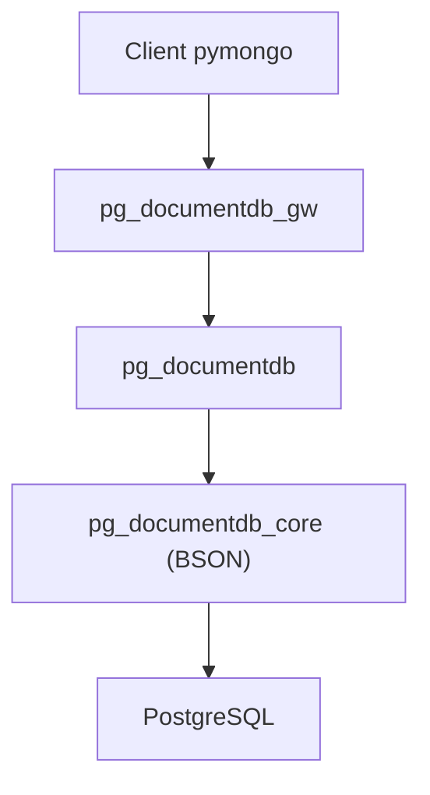

# documentdb/documentdb

> MongoDB-compatible document database built on PostgreSQL, for teams that want BSON without MongoDB.

## The problem
Keeping MongoDB-compatible document storage while staying on PostgreSQL, under a permissive license.

## What it actually does
Adds to PostgreSQL the BSON type (`pg_documentdb_core`), a CRUD document API (`pg_documentdb`) and a gateway that translates the MongoDB protocol into PostgreSQL queries (`pg_documentdb_gw`). The README also announces full-text search, geospatial queries and vector search. A local Docker image is provided.

## How it is wired


## Trying it
```bash
docker pull ghcr.io/documentdb/documentdb/documentdb-local:latest
docker tag ghcr.io/documentdb/documentdb/documentdb-local:latest documentdb
docker run -dt -p 10260:10260 --name documentdb-container documentdb --username <YOUR_USERNAME> --password <YOUR_PASSWORD>
pip install pymongo
```

## Cost and gotchas
Free. Docker required. The example connects with `tlsAllowInvalidCertificates=true`: acceptable locally, not elsewhere.

## What it is not
Not MongoDB: the targeted compatibility is not guaranteed on every command, and the README gives neither a benchmark nor a compatibility list. Not a managed service, the repository shows the local installation.

## Alternatives
- FerretDB: the README cites its integration of DocumentDB as an engine.

## For you
Worth watching: handy for storing documents on PostgreSQL, with the announced vector search, but the project is less than two years old and the README quantifies nothing.
