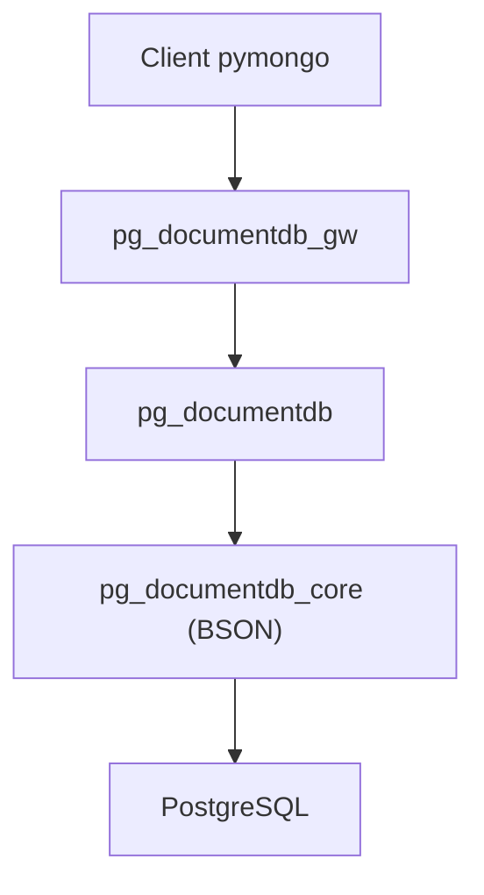

# documentdb/documentdb

> Base de documents compatible MongoDB construite sur PostgreSQL, pour équipes qui veulent du BSON sans MongoDB.

## Le problème
Garder du stockage de documents compatible MongoDB tout en restant sur PostgreSQL, sous licence permissive.

## Ce que ça fait vraiment
Ajoute à PostgreSQL le type BSON (`pg_documentdb_core`), une API de documents CRUD (`pg_documentdb`) et une passerelle qui traduit le protocole MongoDB en requêtes PostgreSQL (`pg_documentdb_gw`). Le README annonce aussi recherche plein texte, requêtes géospatiales et recherche vectorielle. Une image Docker locale est fournie.

## Comment c'est branché


## Essayer
```bash
docker pull ghcr.io/documentdb/documentdb/documentdb-local:latest
docker tag ghcr.io/documentdb/documentdb/documentdb-local:latest documentdb
docker run -dt -p 10260:10260 --name documentdb-container documentdb --username <YOUR_USERNAME> --password <YOUR_PASSWORD>
pip install pymongo
```

## Coût et pièges
Gratuit. Docker requis. L'exemple se connecte avec `tlsAllowInvalidCertificates=true` : acceptable en local, pas ailleurs.

## Ce que ce n'est pas
Pas MongoDB : la compatibilité visée n'est pas garantie sur chaque commande, et le README ne donne ni benchmark ni liste de compatibilité. Pas de service géré, le dépôt montre l'installation locale.

## Alternatives
- FerretDB : le README cite son intégration de DocumentDB comme moteur.

## Pour toi
À surveiller : pratique pour stocker des documents sur PostgreSQL, avec la recherche vectorielle annoncée, mais le projet a moins de deux ans et le README ne chiffre rien.

