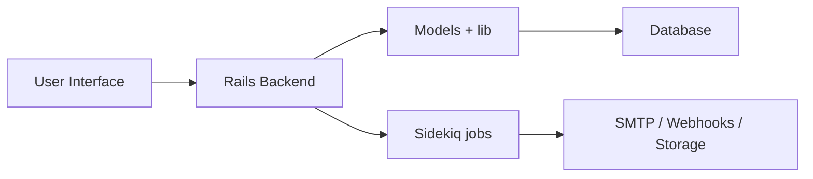

# docusealco/docuseal

> Open source platform for filling and signing PDFs online, a self-hosted alternative to signature services.

## The problem
Getting documents signed often requires a paid SaaS and sending the documents to a third party.

## What it actually does
Rails application: WYSIWYG PDF field editor (12 types), multiple signers, SMTP emails, disk/S3/Google/Azure storage, PDF signing and verification, API and webhooks, Sidekiq jobs, SQLite database by default (PostgreSQL or MySQL possible). Pro features are separate (white label, SSO/SAML, SMS, bulk sending).

## How it is wired


## Trying it
```sh
docker run --name docuseal -p 3000:3000 -v.:/data docuseal/docuseal
sudo HOST=your-domain-name.com docker compose up
```

## Cost and gotchas
Open version free (AGPL-3.0); Pro features paid. A domain and DNS are required for HTTPS via Caddy.

## What it is not
Not a guaranteed qualified signature: the README mentions compliance without detailing it.

## Alternatives
No alternative named in the README.

## For you
Document management tool outside the data/AI scope: ignore.
