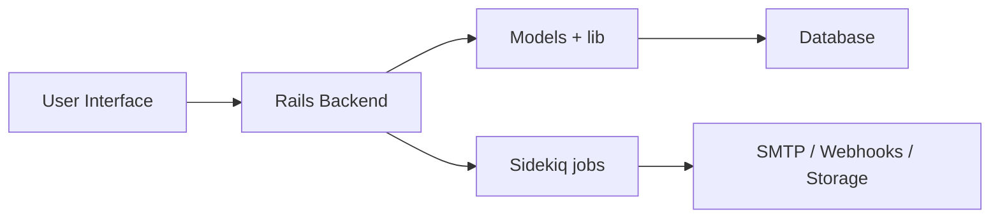

# docusealco/docuseal

> Plateforme open source pour remplir et signer des PDF en ligne, alternative auto-hébergée aux services de signature.

## Le problème
Faire signer des documents exige souvent un SaaS payant et l'envoi des documents chez un tiers.

## Ce que ça fait vraiment
Application Rails : éditeur WYSIWYG de champs PDF (12 types), plusieurs signataires, e-mails SMTP, stockage disque/S3/Google/Azure, signature PDF et vérification, API et webhooks, tâches Sidekiq, base SQLite par défaut (PostgreSQL ou MySQL possibles). Fonctions Pro à part (marque blanche, SSO/SAML, SMS, envoi en masse).

## Comment c'est branché


## Essayer
```sh
docker run --name docuseal -p 3000:3000 -v.:/data docuseal/docuseal
sudo HOST=your-domain-name.com docker compose up
```

## Coût et pièges
Version ouverte gratuite (AGPL-3.0) ; fonctions Pro payantes. Un domaine et DNS sont nécessaires pour le HTTPS via Caddy.

## Ce que ce n'est pas
Pas une signature qualifiée garantie : le README parle de conformité sans la détailler.

## Alternatives
Aucune alternative nommée dans le README.

## Pour toi
Outil de gestion documentaire hors périmètre data/IA : à ignorer.

