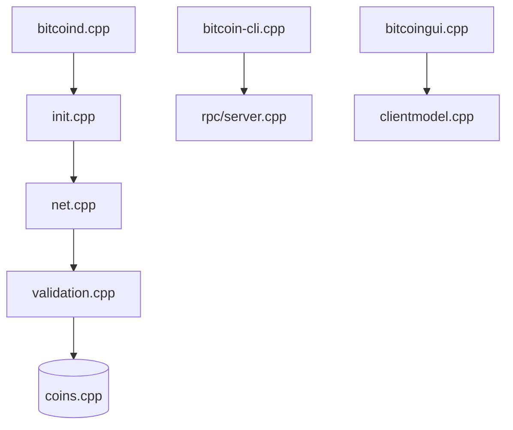

# dogecoin/dogecoin

> Full node software for the Dogecoin cryptocurrency, adapted from Bitcoin Core.

## The problem
Taking part in the Dogecoin network requires a node that synchronizes, validates and stores the blockchain.

## What it actually does
Runs a node: P2P synchronization, validation, chain state, mempool and fee estimation. Exposes a wallet and a JSON-RPC API via `dogecoin-cli`, plus a Qt interface. Proof of work with Scrypt. Default ports: 22556 (P2P) and 22555 (RPC).

## How it is wired

## Trying it
No build command in the README: it points to the installation guide. For RPC help: `dogecoin-cli help`.

## Cost and gotchas
Free. Since August 2024, `master` is unstable: use a tagged release for production binaries. Do not expose the RPC port to the internet. Disk space and bandwidth for the node are not specified.

## What it is not
Not a financial investment or a mobile wallet. Not a data analysis tool.

## Alternatives
No alternative named in the README (Bitcoin Core is cited as the original base).

## For you
To ignore: a cryptocurrency node has no link with models or pipelines.
