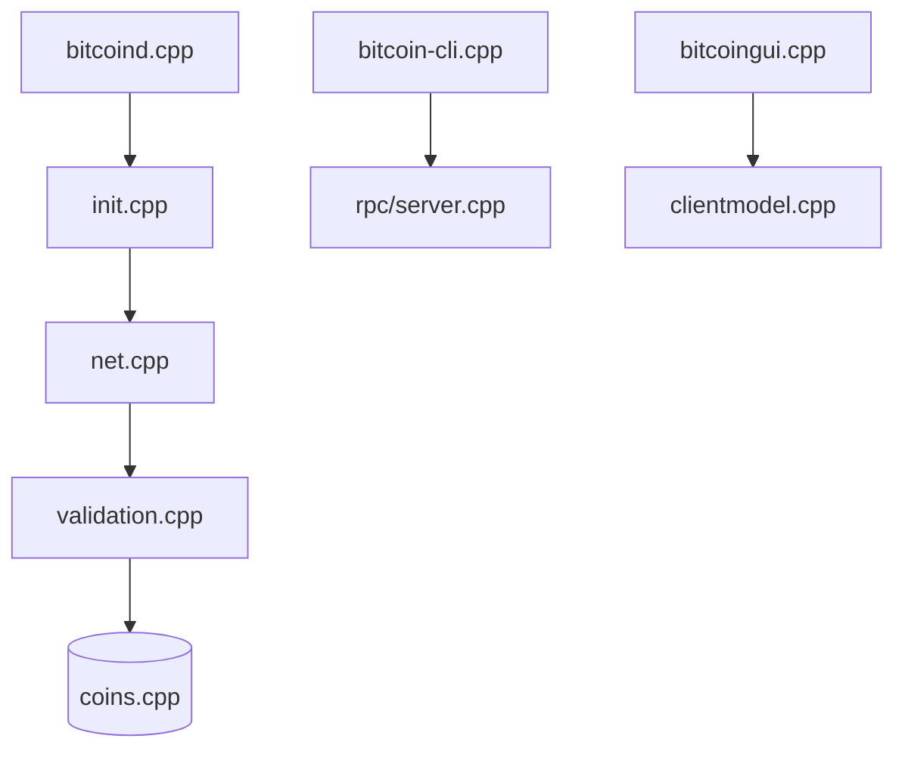

# dogecoin/dogecoin

> Logiciel de nœud complet de la cryptomonnaie Dogecoin, adapté de Bitcoin Core.

## Le problème
Participer au réseau Dogecoin demande un nœud qui synchronise, valide et stocke la chaîne de blocs.

## Ce que ça fait vraiment
Fait tourner un nœud : synchronisation P2P, validation, état de la chaîne, mempool et estimation des frais. Expose un portefeuille et une API JSON-RPC via `dogecoin-cli`, plus une interface Qt. Preuve de travail avec Scrypt. Ports par défaut : 22556 (P2P) et 22555 (RPC).

## Comment c'est branché

## Essayer
Aucune commande de compilation dans le README : il renvoie au guide d'installation. Pour l'aide RPC : `dogecoin-cli help`.

## Coût et pièges
Gratuit. Depuis août 2024, `master` est instable : utiliser une version étiquetée pour des binaires de production. Ne pas exposer le port RPC sur internet. Espace disque et bande passante du nœud non précisés.

## Ce que ce n'est pas
Ce n'est pas un placement financier ni un portefeuille mobile. Ce n'est pas un outil d'analyse de données.

## Alternatives
Aucune alternative nommée dans le README (Bitcoin Core est cité comme base d'origine).

## Pour toi
À ignorer : un nœud de cryptomonnaie n'a pas de lien avec les modèles ni les pipelines.

