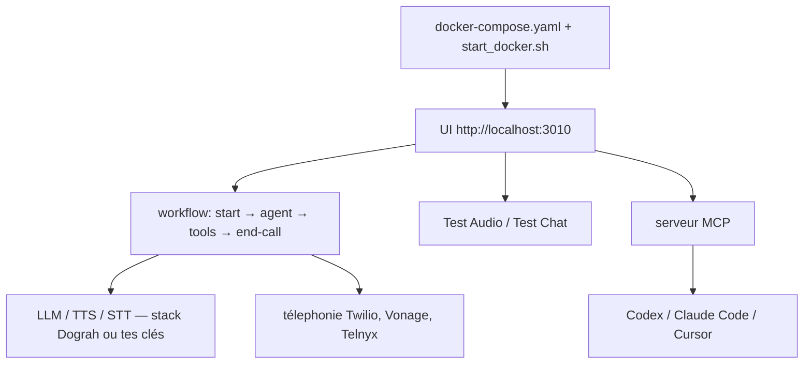

# dograh-hq/dograh

> Self-hostable visual builder for voice agents, an open alternative to Vapi and Retell.

## The problem
Voice agent platforms are proprietary, billed per minute, and your data flows through their cloud.
You cannot change the behavior beyond what the vendor exposes.

## What it actually does
A visual workflow builder: start nodes, agent nodes, global instructions, tools, transitions, end-of-call outputs, a QA node, knowledge bases and webhooks.
Two test modes: "Test Audio" to talk to the agent in the browser, "Test Chat" to iterate faster in text, with the ability to edit or replay a user turn and regenerate the responses from that point.
Built-in telephony: Twilio, Vonage, Telnyx, Plivo, Vobiz, Cloudonix, Asterisk ARI, with transfer to a human on compatible providers.
An MCP server lets Codex, Claude Code or Cursor inspect existing agents, read node schemas, create workflows and save drafts.

## How it is wired


## Trying it
```bash
curl -o docker-compose.yaml https://raw.githubusercontent.com/dograh-hq/dograh/main/docker-compose.yaml && curl -o start_docker.sh https://raw.githubusercontent.com/dograh-hq/dograh/main/scripts/start_docker.sh && chmod +x start_docker.sh && ./start_docker.sh
```

## Cost and gotchas
Self-hosted, it is free under BSD 2-Clause; the cloud offering is billed by usage. No key is required to start, as the LLM/TTS/STT stack is provided.
Anonymous usage data is collected by default: set `ENABLE_TELEMETRY=false` before the start script. First launch: 2–3 minutes of image downloads.

## What it is not
It is not a building block: it is a full stack (Python backend, UI, MinIO, telephony) that you have to run.
The comparison table against Vapi and Retell is written by the vendor; "#1 Product of the Day" on Product Hunt is not technical proof.

## Alternatives
- Vapi: proprietary SaaS, if you do not want to self-host.
- Retell: same, compared on the same axes in the README.

## For you
Worth a look if voice interests you and data residency matters; otherwise it is a heavy stack for an occasional need.
