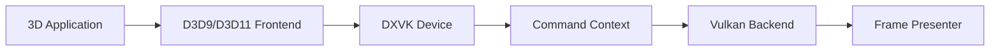

# doitsujin/dxvk

> Direct3D 8/9/10/11 to Vulkan translation layer for gaming on Linux with Wine.

## The problem
Windows games use Direct3D, which is absent on Linux; without translation they run poorly or not at all.

## What it actually does
DLLs (d3d8, d3d9, d3d10core, d3d11, dxgi) replace Wine's: each API is translated into Vulkan commands through a common core (device, context, pipelines, GPU queries), with asynchronous shader compilation and a graphics pipeline library. Configurable HUD (`DXVK_HUD`), logs, GPU filter. A "Native" version without Wine via SDL3/SDL2/GLFW.

## How it is wired


## Trying it
```bash
export WINEPREFIX=/path/to/wineprefix
cp x64/*.dll $WINEPREFIX/drive_c/windows/system32
cp x32/*.dll $WINEPREFIX/drive_c/windows/syswow64
winecfg
```

## Cost and gotchas
Free; a recent Vulkan driver is required. Risk of account bans in multiplayer games (README). Steam Play, Lutris, Bottles handle it automatically.

## What it is not
Not a full emulator: it only translates the graphics APIs.

## Alternatives
No alternative named in the README (wined3d is the implicit comparison base).

## For you
Useful to Linux gamers, foreign to a data/AI path: ignore.
