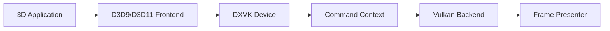

# doitsujin/dxvk

> Couche de traduction Direct3D 8/9/10/11 vers Vulkan pour jouer sous Linux avec Wine.

## Le problème
Les jeux Windows utilisent Direct3D, absent de Linux ; sans traduction ils tournent mal ou pas du tout.

## Ce que ça fait vraiment
Des DLL (d3d8, d3d9, d3d10core, d3d11, dxgi) remplacent celles de Wine : chaque API est traduite en commandes Vulkan via un cœur commun (device, contexte, pipelines, requêtes GPU), avec compilation asynchrone des shaders et bibliothèque de pipeline graphique. HUD configurable (`DXVK_HUD`), journaux, filtre de GPU. Version « Native » sans Wine via SDL3/SDL2/GLFW.

## Comment c'est branché


## Essayer
```bash
export WINEPREFIX=/path/to/wineprefix
cp x64/*.dll $WINEPREFIX/drive_c/windows/system32
cp x32/*.dll $WINEPREFIX/drive_c/windows/syswow64
winecfg
```

## Coût et pièges
Gratuit ; pilote Vulkan récent exigé. Risque de bannissement de compte dans les jeux multijoueurs (README). Steam Play, Lutris, Bottles s'en chargent seuls.

## Ce que ce n'est pas
Pas un émulateur complet : il ne traduit que les API graphiques.

## Alternatives
Aucune alternative nommée dans le README (wined3d est la base de comparaison implicite).

## Pour toi
Utile aux joueurs Linux, étranger à un parcours data/IA : à ignorer.

