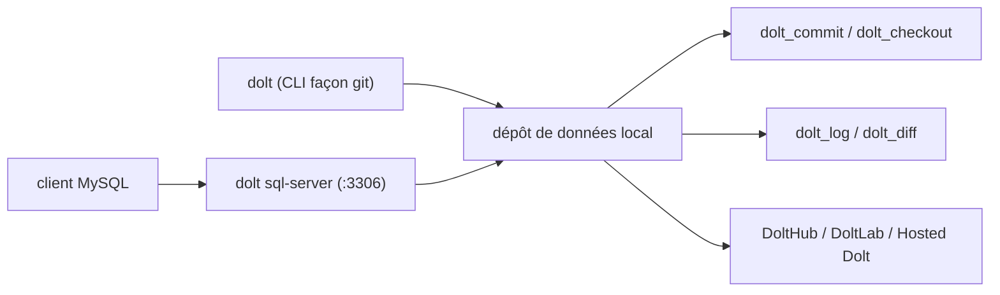

# dolthub/dolt

> A MySQL-compatible SQL database you can branch, commit, fork and merge like a Git repository.

## The problem
Git versions files, not tables. An evolving dataset has no diff, no blame,
no branches and no rollback — just dated dumps that nobody knows how to compare.

## What it actually does
A full MySQL server (foreign keys, secondary indexes, triggers, constraints, procedures,
up to twelve joined tables) paired with versioning. In the CLI, all the Git commands exist
(`add`, `commit`, `diff`, `branch`, `merge`, `cherry-pick`, `revert`, `blame`, `filter-branch`).
In SQL, reads go through system tables (`dolt_log`, `dolt_status`, `dolt_diff`,
`dolt_diff_<table>`) and writes go through procedures (`dolt_add`, `dolt_commit`, `dolt_checkout`,
`dolt_reset`, `dolt_revert`, `dolt_undrop`).

## How it is wired


## Trying it
```bash
sudo bash -c 'curl -L https://github.com/dolthub/dolt/releases/latest/download/install.sh | bash'
dolt config --global --add user.email YOU@DOMAIN.COM
dolt sql-server
dolt -u root -p "" sql
```

## Cost and gotchas
A ~103 MB binary, nothing else. The MySQL client must be version 8.4: version 9.0 changes
authentication and does not connect by default. A Dolt commit is not a SQL `COMMIT` —
two distinct notions, reconciled by the `@@dolt_transaction_commit` variable.

## What it is not
Not PostgreSQL: for that, the README points to Doltgres, still in beta. Not a file store:
Dolt versions tables, not CSVs sitting next to it. DoltHub, DoltLab and Hosted Dolt
are separate products, paid for private hosting.

## Alternatives
- Doltgres: the same idea on the Postgres protocol, announced as beta.
- DoltHub: free public hosting, if you do not want a server.
- DoltLab: self-hosted DoltHub, if the data must not leave your premises.

## For you
The right tool for versioning a reference dataset or an agent's memory: the README explicitly claims this use.
