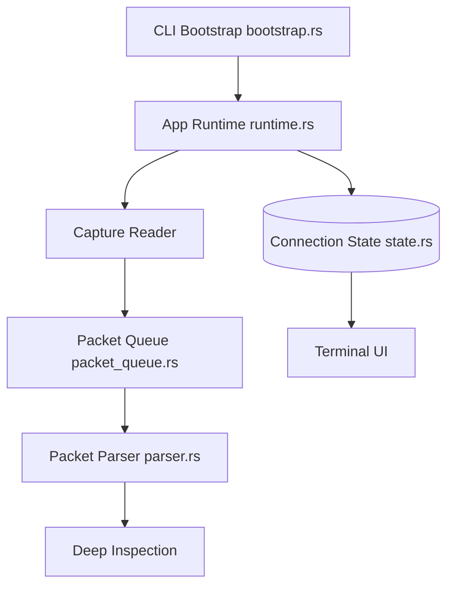

# domcyrus/rustnet

> Terminal network monitor that shows live TCP, UDP and QUIC connections with the associated process.

## The problem
Knowing which process talks to whom on the network means chaining several command-line tools.

## What it actually does
It captures packets (libpcap/Npcap), identifies HTTP, TLS/SNI, DNS, SSH and QUIC, attaches each connection to a process, then displays it in a terminal interface usable over SSH. Headless mode with versioned JSON, PCAP/PCAPNG export for Wireshark, filters, passive DNS and optional Kubernetes attribution. Written in Rust.

## How it is wired


## Trying it
```bash
brew install rustnet
rustnet
cargo install rustnet-monitor
```

## Cost and gotchas
Free, Apache-2.0. Packet capture requires privileges (Linux capabilities, `sudo` on macOS with PKTAP, Npcap on Windows). The README notes that guides on `main` may describe unreleased changes.

## What it is not
It is not an IDS or a firewall. Only the `rustnet` binary is supported: the APIs of the internal crates may change.

## Alternatives
- Wireshark: in-depth analysis of captures exported as PCAPNG.

## For you
Worth watching: useful for diagnosing the traffic of an inference server or a container, with no direct link to ML.
