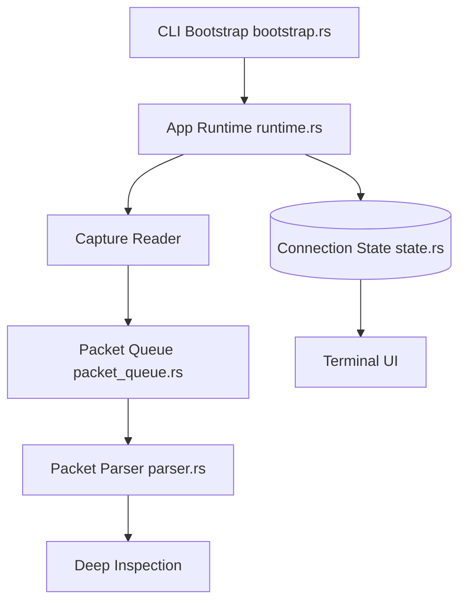

# domcyrus/rustnet

> Moniteur réseau en terminal qui montre connexions TCP, UDP et QUIC en direct avec le processus associé.

## Le problème
Savoir quel processus parle à qui sur le réseau oblige à enchaîner plusieurs outils en ligne de commande.

## Ce que ça fait vraiment
Il capture les paquets (libpcap/Npcap), identifie HTTP, TLS/SNI, DNS, SSH et QUIC, rattache chaque connexion à un processus, puis l'affiche dans une interface terminal utilisable en SSH. Mode sans interface en JSON versionné, export PCAP/PCAPNG pour Wireshark, filtres, DNS passif et attribution Kubernetes optionnelle. Écrit en Rust.

## Comment c'est branché


## Essayer
```bash
brew install rustnet
rustnet
cargo install rustnet-monitor
```

## Coût et pièges
Gratuit, Apache-2.0. La capture de paquets exige des droits (capacités Linux, `sudo` sur macOS avec PKTAP, Npcap sous Windows). Le README précise que les guides sur `main` peuvent décrire des changements non publiés.

## Ce que ce n'est pas
Ce n'est pas un IDS ni un pare-feu. Seul le binaire `rustnet` est supporté : les API des crates internes peuvent changer.

## Alternatives
- Wireshark : analyse approfondie des captures exportées en PCAPNG.

## Pour toi
À surveiller : utile pour diagnostiquer le trafic d'un serveur d'inférence ou d'un conteneur, sans rapport direct avec le ML.

