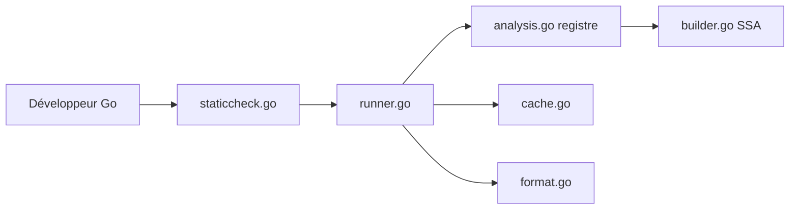

# dominikh/go-tools

> Staticcheck, the static analyzer for Go that detects bugs, slowness and unused code.

## The problem
The Go compiler lets subtle bugs, deprecated APIs and dead code through. Without static analysis, they are only caught in review or in production.

## What it actually does
Staticcheck loads packages, runs registered checks (bugs, simplifications, style, unused code) and prints the diagnostics, with a results cache. The analysis relies on an SSA representation, including a nil analysis. The repo also contains `structlayout`, `structlayout-optimize` and `structlayout-pretty` for the memory layout of structs.

## How it is wired


## Trying it
```bash
go install honnef.co/go/tools/cmd/staticcheck@2022.1
```

## Cost and gotchas
Free, funded by sponsors. The README recommends tagged versions; the master branch may break the build. The internal libraries have no stable API.

## What it is not
Not a formatter nor a testing tool. The repo's libraries are not meant to be imported. 578 open issues.

## Alternatives
No alternative named in the README.

## For you
Worth watching: useful if you write Go (MLOps tools, operators), otherwise irrelevant for Python.
