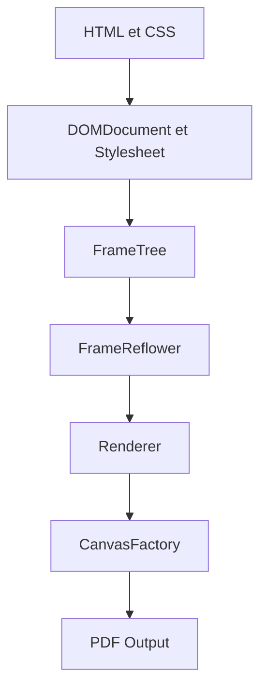

# dompdf/dompdf

> HTML to PDF converter written in PHP, for web developers who generate documents server-side.

## The problem
Produce laid-out PDFs from HTML and CSS, without an external PDF library, in a PHP application.

## What it actually does
It reads HTML and CSS 2.1 (with a few CSS3 properties), builds a frame tree, applies layout, then writes a PDF. It handles tables, images, embedded fonts and external stylesheets. The flow goes through a rendering adapter (Cpdf, GD or PDFlib).

## How it is wired


## Trying it
```bash
composer require dompdf/dompdf
```
```php
use Dompdf\Dompdf;
$dompdf = new Dompdf();
$dompdf->loadHtml('hello world');
$dompdf->setPaper('A4', 'landscape');
$dompdf->render();
$dompdf->stream();
```

## Cost and gotchas
Free, LGPL-2.1 license. Requires PHP 7.1 or higher and the DOM, MBString and GD extensions. Access to remote resources requires enabling `isRemoteEnabled`.

## What it is not
It is not a browser engine: no flexbox or CSS grid, table rows do not split across pages. An instance must be used for a single document only.

## Alternatives
No alternative named in the README, apart from Symfony and Laravel integrations.

## For you
Ignore: PHP PDF generation tool, outside the data, AI or MLOps scope.
