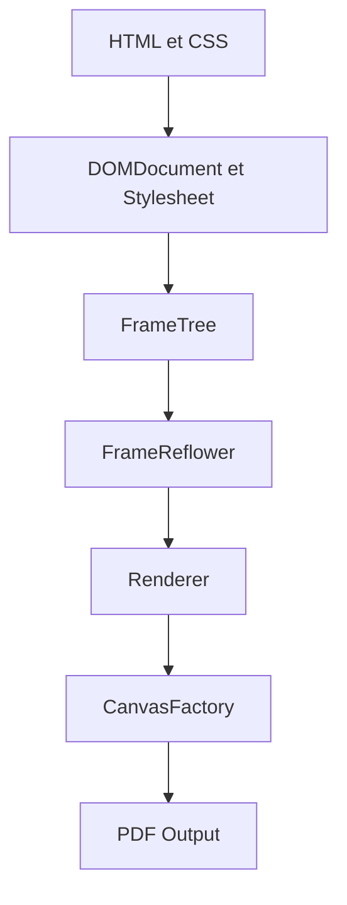

# dompdf/dompdf

> Convertisseur HTML vers PDF écrit en PHP, pour les développeurs web qui génèrent des documents côté serveur.

## Le problème
Produire des PDF mis en page depuis du HTML et du CSS, sans bibliothèque PDF externe, dans une application PHP.

## Ce que ça fait vraiment
Il lit du HTML et du CSS 2.1 (avec quelques propriétés CSS3), construit une arbre de cadres, applique la mise en page puis écrit un PDF. Il gère tableaux, images, polices embarquées et feuilles de style externes. Le flux passe par un adaptateur de rendu (Cpdf, GD ou PDFlib).

## Comment c'est branché


## Essayer
```bash
composer require dompdf/dompdf
```
```php
use Dompdf\Dompdf;
$dompdf = new Dompdf();
$dompdf->loadHtml('hello world');
$dompdf->setPaper('A4', 'landscape');
$dompdf->render();
$dompdf->stream();
```

## Coût et pièges
Gratuit, licence LGPL-2.1. Il faut PHP 7.1 ou plus et les extensions DOM, MBString et GD. L'accès à des ressources distantes demande d'activer `isRemoteEnabled`.

## Ce que ce n'est pas
Ce n'est pas un moteur de navigateur : pas de flexbox ni de grille CSS, les lignes de tableau ne se coupent pas entre pages. Une instance ne doit servir qu'un seul document.

## Alternatives
Aucune alternative nommée dans le README, hors intégrations Symfony et Laravel.

## Pour toi
Ignorer : outil PHP de génération de PDF, hors du périmètre data, IA ou MLOps.

