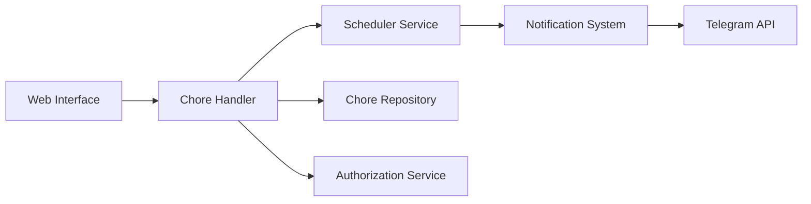

# donetick/donetick

> Self-hosted application for shared tasks and chores, with rotation, points and notifications.

## The problem
Distributing recurring tasks across a household or a team without anyone forgetting them.

## What it actually does
Go server with SQLite: natural-language task creation, flexible recurrence (including adaptive), assignee rotation, subtasks, labels, "Things" (tracked values), NFC tags, points, statistics. Local login or OIDC with group-based roles, TOTP MFA, REST API, webhooks, Home Assistant integration, Telegram, Discord and Pushover notifications.

## How it is wired


## Trying it
```bash
docker pull donetick/donetick
docker run \
  -v /path/to/host/data:/donetick-data \
  -v /path/to/host/config:/config \
  -p 2021:2021 \
  -e DT_ENV=selfhosted \
  -e DT_SQLITE_PATH=/donetick-data/donetick.db \
  donetick/donetick
```

## Cost and gotchas
Free. A `selfhosted.yaml` file is required. Offline mode is very limited, the iOS app is in alpha. 184 open issues.

## What it is not
Not a data/AI work tool nor a full team project manager.

## Alternatives
No alternative named in the README.

## For you
Ignore for professional watch: a well-made household application, but unrelated to data, AI or MLOps.
