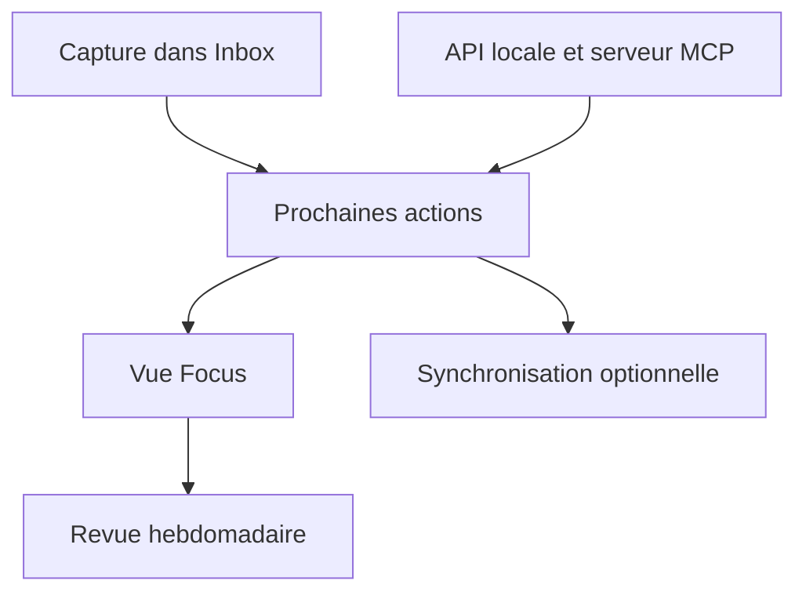

# dongdongbh/Mindwtr

> Free, offline task app following the GTD method, on every system.

## The problem
Conventional task apps force an account on you, lock in your data and follow the GTD method only partially.

## What it actually does
A GTD to-do list: inbox, next actions, waiting for, someday/maybe, guided weekly review. It works offline without an account, on Windows, macOS, Linux, iOS and Android. Sync is optional (iCloud, Dropbox, folder, WebDAV, personal server). Import comes from Todoist, TickTick, OmniFocus. AI is disabled by default.

## How it is wired
Simplified diagram based on the card, no diagram provided.



## Trying it
```bash
flatpak install flathub tech.dongdongbh.mindwtr
yay -S mindwtr-bin
brew install --cask mindwtr
```

## Cost and gotchas
Free. The sync server and the web app are self-hosted, your choice. AGPL-3.0 licence: restrictive if you want to integrate the code.

## What it is not
Not a team tool: it is designed for personal tasks, with no streak tracking or productivity scores.

## Alternatives
- Todoist, TickTick, Everdo, NirvanaHQ: compared in the README; the first two are closed and paid.

## For you
Ignore for your data / AI work, but useful as a personal task manager if you like GTD.
