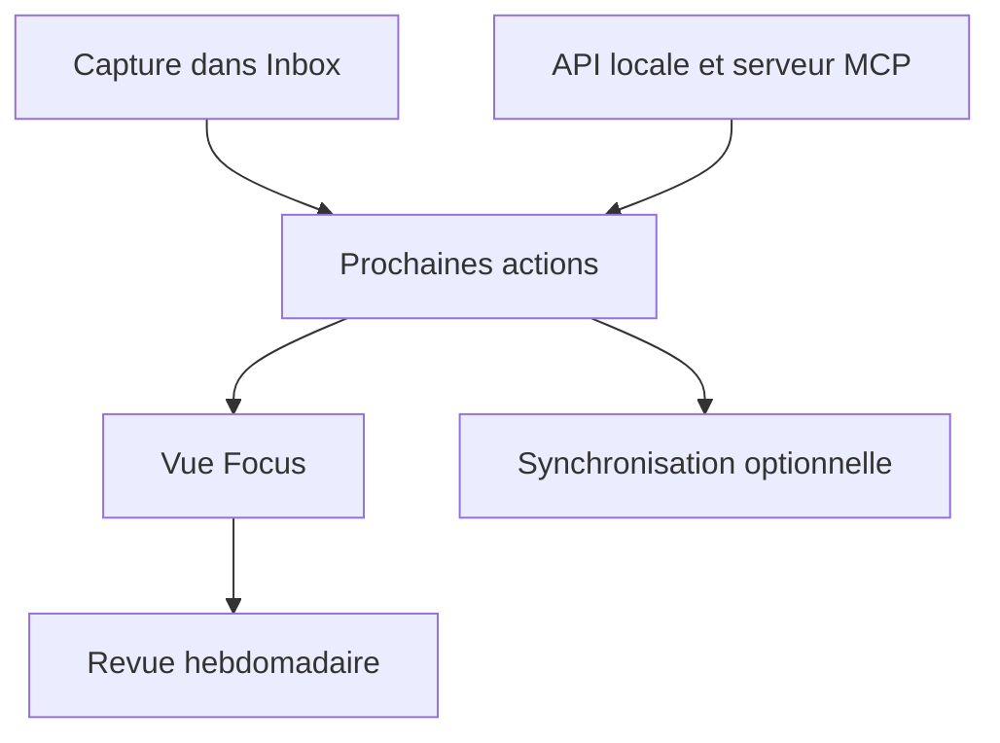

# dongdongbh/Mindwtr

> Application de tâches libre selon la méthode GTD, hors ligne, sur tous les systèmes.

## Le problème
Les applications de tâches classiques imposent un compte, enferment les données et suivent la méthode GTD de façon partielle.

## Ce que ça fait vraiment
Une liste de tâches GTD : boîte de réception, prochaines actions, en attente, un jour peut-être, revue hebdomadaire guidée. Elle marche hors ligne sans compte, sur Windows, macOS, Linux, iOS et Android. La synchronisation est optionnelle (iCloud, Dropbox, dossier, WebDAV, serveur perso). L'import vient de Todoist, TickTick, OmniFocus. L'IA est désactivée par défaut.

## Comment c'est branché
Schéma simplifié d'après la fiche, sans diagramme fourni.



## Essayer
```bash
flatpak install flathub tech.dongdongbh.mindwtr
yay -S mindwtr-bin
brew install --cask mindwtr
```

## Coût et pièges
Gratuit. Le serveur de synchronisation et l'application web sont à héberger soi-même, au choix. Licence AGPL-3.0 : contraignante si tu veux intégrer le code.

## Ce que ce n'est pas
Pas un outil d'équipe : il est conçu pour des tâches personnelles, sans suivi de séries ni scores de productivité.

## Alternatives
- Todoist, TickTick, Everdo, NirvanaHQ : comparés dans le README ; les deux premiers sont fermés et payants.

## Pour toi
À ignorer pour ton travail data / IA, mais utile comme gestionnaire de tâches personnel si tu aimes GTD.

