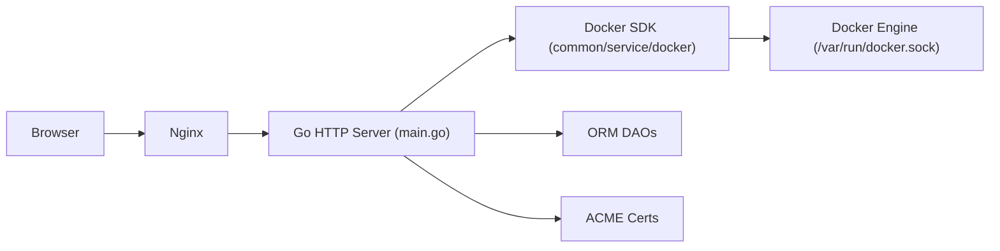

# donknap/dpanel

> Lightweight web panel to manage Docker and Podman containers, documented mostly in Chinese.

## The problem
Managing containers, images, files and Compose from a browser avoids the command line on a personal or team server.

## What it actually does
A single container exposes a web interface (React, UmiJS, Ant Design) in front of a Go server. According to the code, the server drives Docker via `/var/run/docker.sock` with the Docker SDK, schedules cron tasks, and handles ACME certificates, SSH, remote storage (rclone), plugins and registry synchronization. Nginx serves the static files and redirects domains. The "Lite" version removes the domains and certificates part; a paid Pro version exists.

## How it is wired


## Trying it
```bash
docker run -d --name dpanel --restart=always \
 -p 80:80 -p 443:443 -p 8807:8080 -e APP_NAME=dpanel \
 -v /var/run/docker.sock:/var/run/docker.sock \
 -v /home/dpanel:/dpanel dpanel/dpanel:latest
```
A `dpanel/dpanel:lite` variant and a `curl … quick.sh | sudo bash` script are also offered.

## Cost and gotchas
The panel mounts the Docker socket: anyone who accesses it controls the host. Images are also on a Chinese registry (Aliyun). Read the installation script before running it. A license is present but not identified by GitHub.

## What it is not
It is not a tool designed for data or MLOps: no orchestration, no job tracking. The documentation, the community (QQ, WeChat) and the sponsors are Chinese; there is no English README.

## Alternatives
No alternative named in the README.

## For you
Ignore: general-purpose container manager, single maintainer, documented in Chinese; it brings nothing specific to a data or AI workflow.
