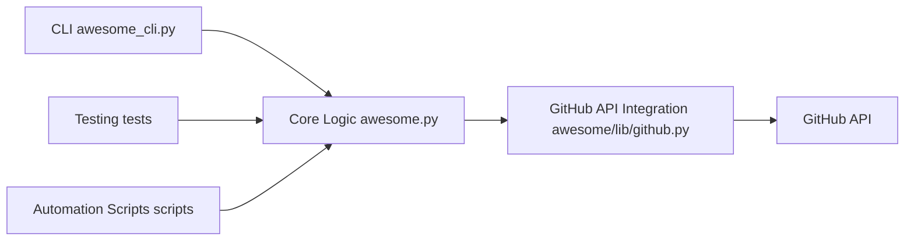

# donnemartin/awesome-aws

> Curated list of AWS SDKs, open source tools, guides and resources.

## The problem
The AWS ecosystem is huge; finding the right community tools for each service takes time.

## What it actually does
Index by language (SDK), by service (Lambda, S3, DynamoDB, Kinesis…), guides, blogs, conferences.
"Fiery Meter": icons based on star count, recomputed by a Python module `awesome-aws` that queries GitHub.
Appendix describing AWS services in one line each.

## How it is wired

## Trying it
No documented command.

## Cost and gotchas
Free. Last push in March 2024; many entries predate that (KPIs, old services).

## What it is not
Not an up-to-date list of AI on AWS: the Machine Learning section boils down to old examples.

## Alternatives
No alternative named other than generic "awesome" lists.

## For you
Ignore: an aging list, of little use for current AWS MLOps; the official docs serve better.
