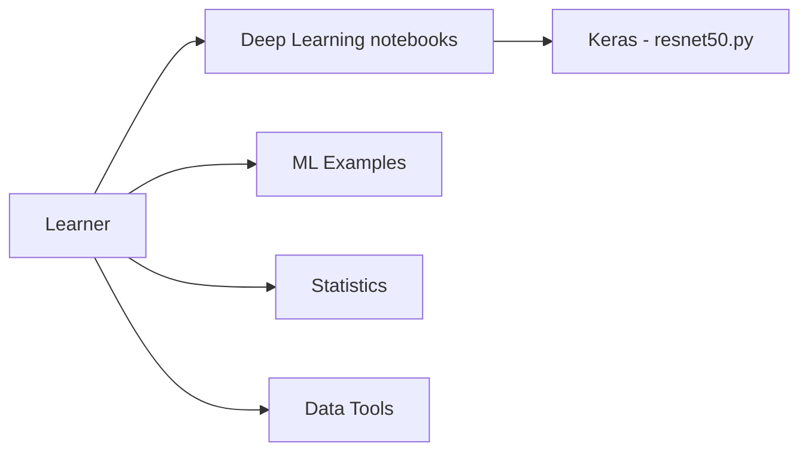

# donnemartin/data-science-ipython-notebooks

> Collection of educational notebooks on deep learning, scikit-learn, pandas and Spark, for beginners.

## The problem
Finding guided, runnable examples to learn the building blocks of data science in Python.

## What it actually does
Notebook index: TensorFlow, Theano, Keras, Caffe, scikit-learn, SciPy, pandas, matplotlib, NumPy, Spark/HDFS, MapReduce with mrjob, AWS, command line, Kaggle (Titanic, churn). The README specifies that the notebooks were tested with Python 2.7.x. The graph lists Keras models (VGG, ResNet50), statistics scripts and NumPy/pandas/matplotlib.

## How it is wired


## Trying it
```bash
git clone https://github.com/donnemartin/data-science-ipython-notebooks.git
cd data-science-ipython-notebooks
jupyter notebook
```

## Cost and gotchas
Free. Dated content: Python 2.7, Theano, Caffe, old TensorFlow APIs. Last push in March 2024.

## What it is not
Not an up-to-date course nor a maintained project: it is an educational leftover. No package to install.

## Alternatives
No alternative named in the README (third-party TensorFlow tutorials are listed there as complements).

## For you
Ignore: outdated technology stack (Python 2.7, Theano); recent resources cover the same topics better.
