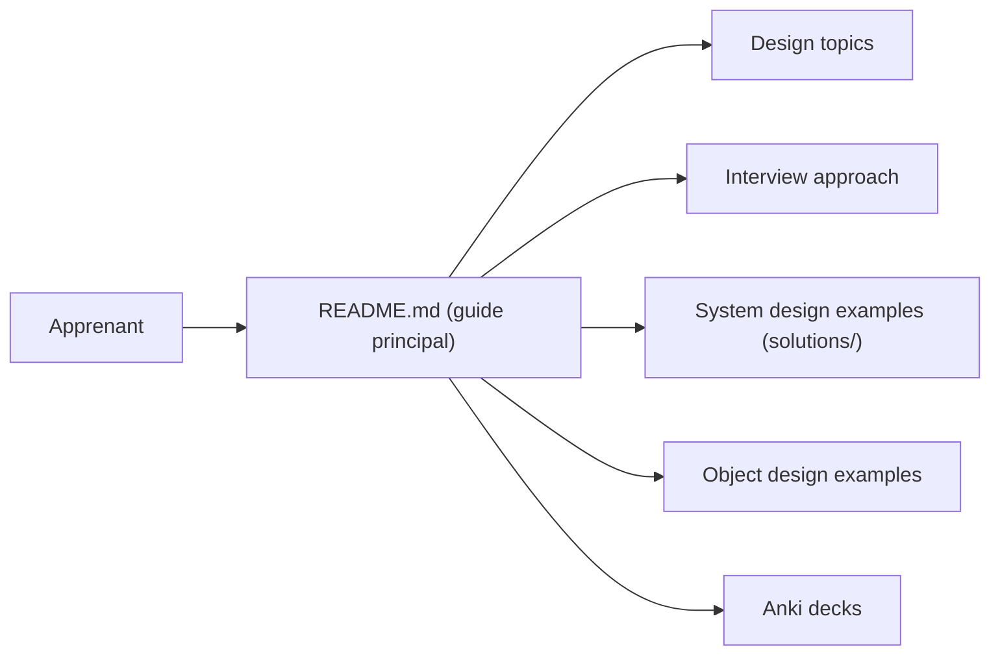

# donnemartin/system-design-primer

> Study guide for designing large-scale systems and preparing for system design interviews.

## The problem
The design principles of distributed systems are scattered across the web, with no order. Preparing for a system design interview, or justifying an architecture choice, means cross-checking everything by hand.

## What it actually does
A long README organised by topic: CAP, consistency, replication, sharding, cache, message queues, REST/RPC, with the drawbacks and links for each topic. It also includes exercises with solutions (Pastebin, crawler, Mint, Twitter, Amazon sales, AWS), object-oriented exercises, latency and powers-of-two tables, and Anki decks. The structure is documentary: the architecture graph does not claim any wiring between examples.

## How it is wired

## Trying it
No command is documented in the README: you read the guide, follow the study plan (short, medium, long term) and practise on the questions with solutions.

## Cost and gotchas
Free. Some of the README's code examples (cache-aside, write-through) are teaching sketches, not code to copy; some references point to old articles. A licence is present but not identified by GitHub: read it before reusing the content.

## What it is not
Neither an interactive course nor a library: nothing to install, nothing to run. The author flags the security section as still to be completed, and the "Under development" part remains empty.

## Alternatives
- kilimchoi/engineering-blogs: the README points to it for adding a company blog to the list.
- checkcheckzz/system-design-interview: cited in the credits as a source of inspiration.
- shashank88/system_design: cited in the credits, same subject.

## For you
Adopt: the cache/database/message-queue trade-offs directly help size an ML pipeline or an inference service, and reading it costs nothing.
