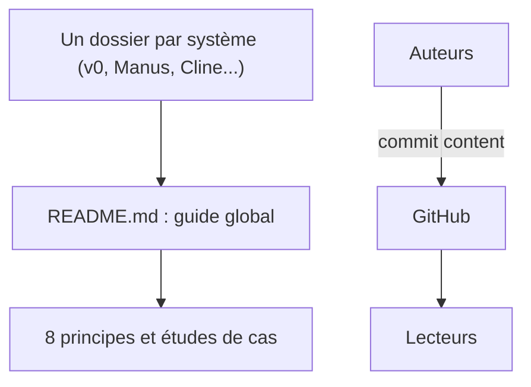

# dontriskit/awesome-ai-system-prompts

> Collection of real agent system prompts, with a best-practices guide for designing your own.

## The problem
Writing an agent's system prompt without seeing how established products structure role, tools, planning and refusals.

## What it actually does
The repo gathers captured prompts (v0, same.new, Manus, ChatGPT, Claude, Cline, Bolt.new, Loveable, Grok and others), one folder per system. The README draws eight principles from them (role, structure, tools, reasoning, environment, domain, safety, tone) with excerpts and sources, then case studies. The README provided is truncated before its conclusions: the rest is not read.

## How it is wired


## Trying it
```bash
# Aucune commande dans le README : lire le README puis le dossier du système voulu.
```

## Cost and gotchas
Free, MIT license. The architecture inferred from the code suggests a static site, a CI and analytics, but none of these appear in the README. The prompts are snapshots dated 2025 and may differ from current versions.

## What it is not
It is not software: there is no code to run. Nor is it an official source; the prompts were extracted by third parties.

## Alternatives
The README names no alternative.

## For you
Worth watching: good material for designing your own agent prompts, to be read as dated content rather than as a reference.
