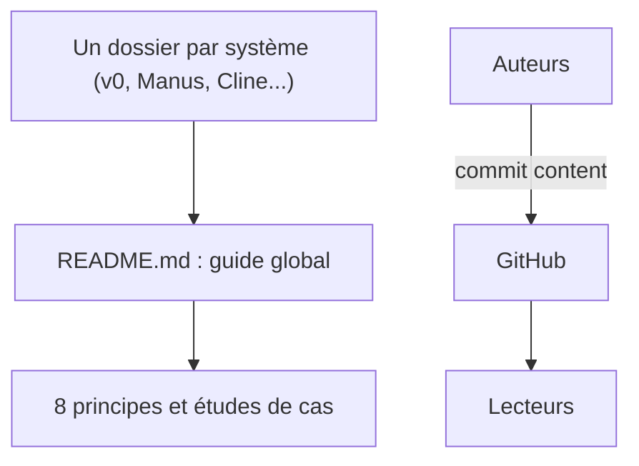

# dontriskit/awesome-ai-system-prompts

> Collection de prompts système d'agents réels, avec un guide des bonnes pratiques pour concevoir les siens.

## Le problème
Écrire le prompt système d'un agent sans voir comment les produits établis structurent rôle, outils, planification et refus.

## Ce que ça fait vraiment
Le dépôt réunit des prompts capturés (v0, same.new, Manus, ChatGPT, Claude, Cline, Bolt.new, Loveable, Grok et d'autres), un dossier par système. Le README en tire huit principes (rôle, structure, outils, raisonnement, environnement, domaine, sécurité, ton) avec extraits et sources, puis des études de cas. Le README fourni est tronqué avant ses conclusions : le reste n'est pas lu.

## Comment c'est branché


## Essayer
```bash
# Aucune commande dans le README : lire le README puis le dossier du système voulu.
```

## Coût et pièges
Gratuit, licence MIT. L'architecture d'après le code évoque un site statique, un CI et de l'analytique, mais aucun de ces éléments n'apparaît dans le README. Les prompts sont des captures datées de 2025 et peuvent différer des versions actuelles.

## Ce que ce n'est pas
Ce n'est pas un logiciel : aucun code à exécuter. Ce n'est pas non plus une source officielle, les prompts sont extraits par des tiers.

## Alternatives
Le README ne cite pas d'alternative nommée.

## Pour toi
À surveiller : bon matériau pour concevoir tes propres prompts d'agents, à lire comme du contenu daté plutôt que comme une référence.

