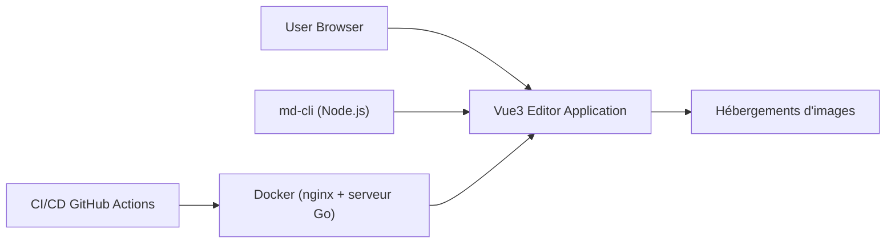

# doocs/md

> Markdown editor that renders text into a layout for WeChat articles, for official-account authors.

## The problem
Formatting WeChat articles is painful. Here, a Markdown document becomes a styled article.

## What it actually does
Vue 3 (Vite) application with live rendering, KaTeX, Mermaid, PlantUML, code themes, local drafts, import/export, and image upload to about ten hosts (GitHub, S3, R2…). It integrates AI models (DeepSeek, OpenAI…). Deployments: online version, Chrome or Firefox extension, `md-cli`, Docker, Cloudflare Workers.

## How it is wired


## Trying it
```bash
nvm i && nvm use
pnpm i
pnpm web dev
npm i -g @doocs/md-cli && md-cli
docker run -d -p 8080:80 doocs/md:latest
```

## Cost and gotchas
Free. Image hosts require keys and tokens. The README, in Chinese, recommends Chrome.

## What it is not
Not a general-purpose editor: it targets the WeChat format. The built-in AI models require your own keys.

## Alternatives
No alternative named in the README.

## For you
Ignore: a WeChat publishing tool, unrelated to data/AI, unless you publish articles there.
