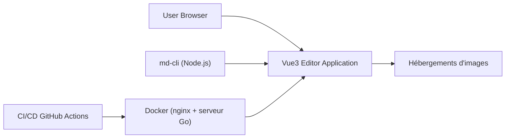

# doocs/md

> Éditeur Markdown qui rend le texte en mise en page pour articles WeChat, pour les auteurs de comptes officiels.

## Le problème
La mise en forme des articles WeChat est pénible. Ici, un document Markdown devient un article stylé.

## Ce que ça fait vraiment
Application Vue 3 (Vite) avec rendu en direct, KaTeX, Mermaid, PlantUML, thèmes de code, brouillons locaux, import/export, et téléversement d'images vers une dizaine d'hébergements (GitHub, S3, R2…). Elle intègre des modèles d'IA (DeepSeek, OpenAI…). Déploiements : version en ligne, extension Chrome ou Firefox, `md-cli`, Docker, Cloudflare Workers.

## Comment c'est branché


## Essayer
```bash
nvm i && nvm use
pnpm i
pnpm web dev
npm i -g @doocs/md-cli && md-cli
docker run -d -p 8080:80 doocs/md:latest
```

## Coût et pièges
Gratuit. Les hébergements d'images demandent clés et jetons. Le README, en chinois, recommande Chrome.

## Ce que ce n'est pas
Pas un éditeur généraliste : il vise le format WeChat. Les modèles d'IA intégrés demandent tes propres clés.

## Alternatives
Aucune alternative nommée dans le README.

## Pour toi
Ignorer : outil de publication WeChat, sans lien avec la data/IA, sauf si tu y publies des articles.

