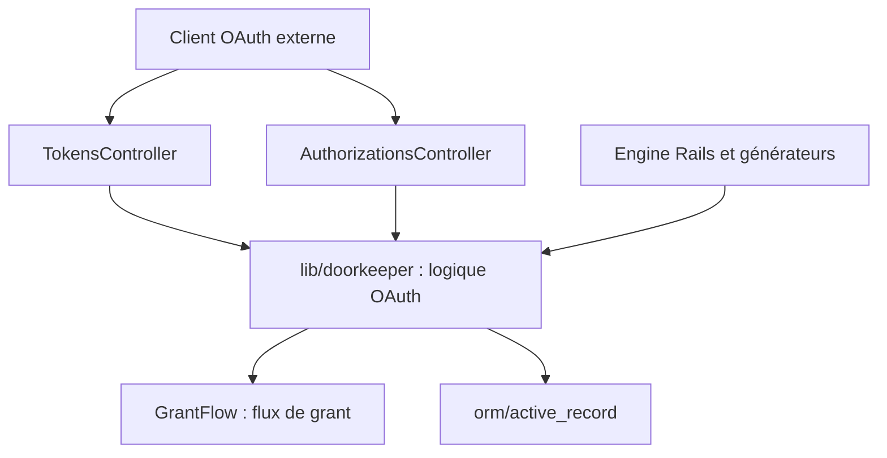

# doorkeeper-gem/doorkeeper

> Rails engine that turns a Ruby or Grape application into an OAuth 2 provider.

## The problem
Writing your own OAuth 2 authorization server is long and risky: tokens, scopes, revocation, multiple flows.

## What it actually does
Doorkeeper adds the OAuth 2 flows (authorization code, client credentials, password, implicit), scopes, refresh, token revocation and introspection, PKCE, resource indicators, and client metadata documents (useful for MCP clients). It stores applications, tokens and codes in a database, by default with Active Record. Extensions add OpenID Connect or JWT.

## How it is wired


## Trying it
```bash
bundle install
rails generate doorkeeper:resource_indicators
rails db:migrate
bundle exec rake doorkeeper:db:cleanup
bundle exec rake doorkeeper:server
```
In the Gemfile: `gem 'doorkeeper'`.

## Cost and gotchas
Free. Requires Rails 5.0 or later and a database. Token tables grow endlessly: schedule the `doorkeeper:db:cleanup` task. Client metadata documents are an IETF draft and require a host filter on your server.

## What it is not
It is not an identity directory or an OAuth client: it issues tokens for your APIs. It only works with Ruby.

## Alternatives
No alternative named in the README, which only lists extensions (OpenID Connect, JWT).

## For you
Ignore: only useful if you expose a Rails API, outside your usual data and MLOps stack.
