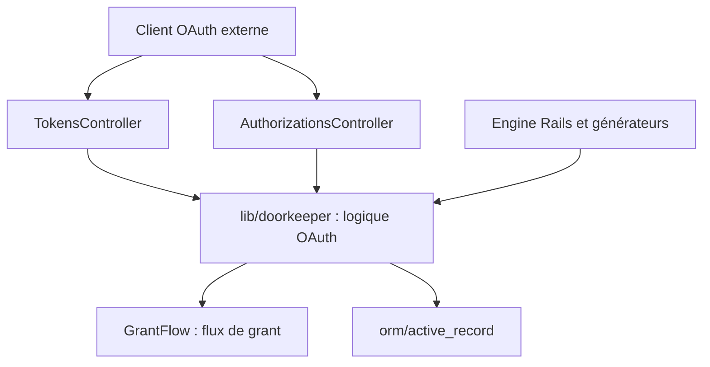

# doorkeeper-gem/doorkeeper

> Moteur Rails qui transforme une application Ruby ou Grape en fournisseur OAuth 2.

## Le problème
Écrire soi-même un serveur d'autorisation OAuth 2 est long et risqué : jetons, portées, révocation, flux multiples.

## Ce que ça fait vraiment
Doorkeeper ajoute les flux OAuth 2 (code d'autorisation, identifiants client, mot de passe, implicite), les portées, le rafraîchissement, la révocation et l'introspection de jetons, PKCE, les indicateurs de ressources et les documents de métadonnées client (utiles aux clients MCP). Il stocke applications, jetons et codes en base, par défaut avec Active Record. Des extensions ajoutent OpenID Connect ou JWT.

## Comment c'est branché


## Essayer
```bash
bundle install
rails generate doorkeeper:resource_indicators
rails db:migrate
bundle exec rake doorkeeper:db:cleanup
bundle exec rake doorkeeper:server
```
Dans le Gemfile : `gem 'doorkeeper'`.

## Coût et pièges
Gratuit. Il faut Rails 5.0 ou plus et une base. Les tables de jetons grossissent sans fin : planifie la tâche `doorkeeper:db:cleanup`. Les documents de métadonnées client sont un brouillon IETF et demandent un filtre d'hôtes sur ton serveur.

## Ce que ce n'est pas
Ce n'est pas un annuaire d'identités ni un client OAuth : il émet des jetons pour tes API. Il ne fonctionne qu'avec Ruby.

## Alternatives
Aucune alternative nommée dans le README, qui liste seulement des extensions (OpenID Connect, JWT).

## Pour toi
À ignorer : utile seulement si tu exposes une API Rails, hors de ta pile data et MLOps habituelle.

