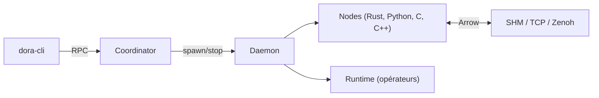

# dora-rs/dora

> Rust dataflow framework for real-time robotics and AI applications, with multi-language nodes.

## The problem
Connecting perception and AI components (camera, detection, display) with low latency, often across several languages and machines.

## What it actually does
Describes a pipeline in YAML: nodes (Rust, Python, C, C++) exchange Apache Arrow messages through shared memory or Zenoh. A CLI manages the lifecycle, with a coordinator and daemon, recording replay, monitoring (`dora top`) and a ROS2 bridge. The announced performance (10 to 17 times ROS2 Python) comes from the README.

## How it is wired


## Trying it
```bash
cargo install dora-cli
pip install dora-rs numpy pyarrow
git clone https://github.com/dora-rs/dora.git && cd dora
dora run examples/python-dataflow/dataflow.yml
```

## Cost and gotchas
Free. The PyPI package is `dora-rs`, not `dora`. The Node Hub is marked unstable; the code is largely produced by AI agents, supervised by humans.

## What it is not
It is not a training engine nor a batch data pipeline orchestrator. Resuming dataflows after a coordinator restart is only partial.

## Alternatives
- ROS2: established robotics ecosystem, with a bridge provided by dora.

## For you
Worth watching: relevant for embedded or real-time AI (vision, robotics), of little use for classic data pipelines.
