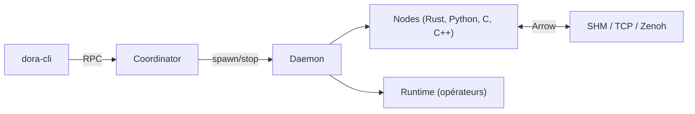

# dora-rs/dora

> Framework Rust de flux de données pour applications robotique et IA temps réel, avec nœuds multi-langages.

## Le problème
Relier des composants de perception et d'IA (caméra, détection, affichage) avec une latence faible, souvent entre plusieurs langages et machines.

## Ce que ça fait vraiment
Décrit un pipeline en YAML : des nœuds (Rust, Python, C, C++) échangent des messages Apache Arrow par mémoire partagée ou Zenoh. Une CLI gère le cycle de vie, avec coordinateur et démon, rejeu d'enregistrements, supervision (`dora top`) et pont ROS2. Les performances annoncées (10 à 17 fois ROS2 Python) viennent du README.

## Comment c'est branché


## Essayer
```bash
cargo install dora-cli
pip install dora-rs numpy pyarrow
git clone https://github.com/dora-rs/dora.git && cd dora
dora run examples/python-dataflow/dataflow.yml
```

## Coût et pièges
Gratuit. Le paquet PyPI est `dora-rs`, pas `dora`. Le Node Hub est marqué instable ; le code est en grande partie produit par des agents IA, supervisés par des humains.

## Ce que ce n'est pas
Ce n'est pas un moteur d'entraînement ni un orchestrateur de pipelines de données batch. La reprise de dataflows après redémarrage du coordinateur n'est que partielle.

## Alternatives
- ROS2 : écosystème robotique établi, avec un pont fourni par dora.

## Pour toi
À surveiller : pertinent pour de l'IA embarquée ou temps réel (vision, robotique), peu utile pour des pipelines data classiques.

