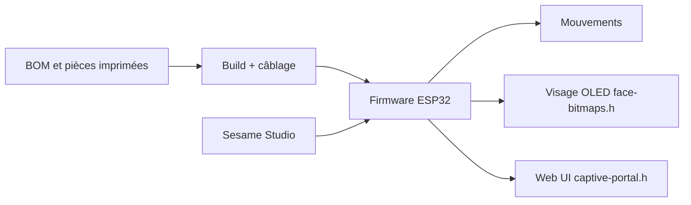

# dorianborian/sesame-robot

> 3D-printable ESP32 quadruped robot with an expressive OLED face, for makers of all levels.

## The problem
Walking robots are expensive or closed; few open projects combine movement, expression and accessibility.

## What it actually does
A repository of CAD files, STLs, assembly and wiring guides, and Arduino firmware for ESP32: eight MG90 servos (two per leg), a 128x64 OLED screen for the face, a web interface via a WiFi access point, a JSON API and a serial CLI. Related projects provide an animation studio, a Rust simulator, ML tools and a Python voice-command application.

## How it is wired


## Trying it
```bash
# Aucune commande dans le README ; étapes : imprimer les STL,
# câbler, puis téléverser le firmware depuis Arduino IDE.
```

## Cost and gotchas
Roughly $50 to $60 of hardware, a 3D printer, basic soldering and the Arduino IDE. The board choice (Lolin S2 Mini, Distro Board V3) determines the power supply.

## What it is not
Not a ready-to-use robot nor a robotics research platform: the ML repository is a separate project.

## Alternatives
- No alternative named in the README.

## For you
Ignore: a maker project outside the data/AI field; only the simulation and RL side, in an external repository, might be relevant.
