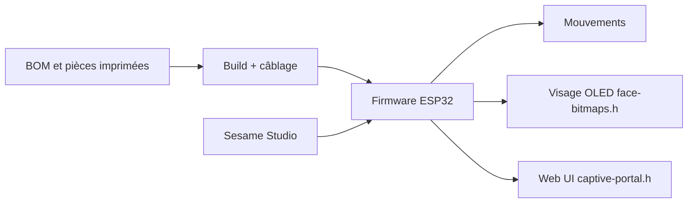

# dorianborian/sesame-robot

> Robot quadrupède ESP32 imprimable en 3D, avec visage OLED expressif, pour makers de tous niveaux.

## Le problème
Les robots marcheurs sont chers ou fermés ; peu de projets ouverts combinent mouvement, expression et accessibilité.

## Ce que ça fait vraiment
Dépôt de fichiers CAD, STL, guides d'assemblage et de câblage, et firmware Arduino pour ESP32 : huit servos MG90 (deux par patte), écran OLED 128x64 pour le visage, interface web via point d'accès WiFi, API JSON et CLI série. Des projets liés fournissent un studio d'animation, un simulateur Rust, des outils ML et une application Python de commande vocale.

## Comment c'est branché


## Essayer
```bash
# Aucune commande dans le README ; étapes : imprimer les STL,
# câbler, puis téléverser le firmware depuis Arduino IDE.
```

## Coût et pièges
Environ 50 à 60 $ de matériel, imprimante 3D, soudure de base et Arduino IDE. Le choix de carte (Lolin S2 Mini, Distro Board V3) conditionne l'alimentation.

## Ce que ce n'est pas
Pas un robot prêt à l'emploi ni une plateforme de recherche robotique : le dépôt ML est un projet séparé.

## Alternatives
- Aucune alternative nommée dans le README.

## Pour toi
À ignorer : projet de maker hors du champ data/IA ; seul le volet simulation et RL, dans un dépôt externe, pourrait en avoir.

