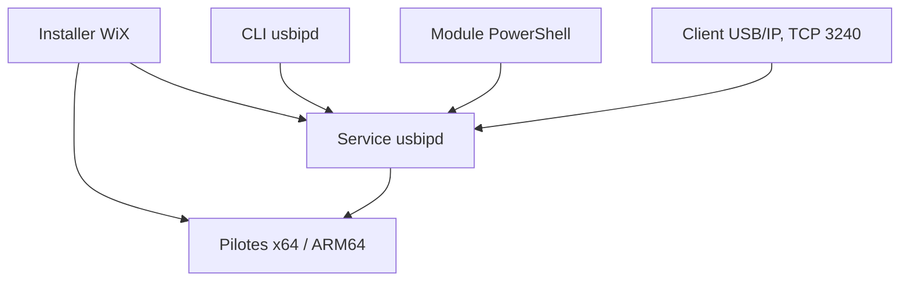

# dorssel/usbipd-win

> Windows service that shares local USB devices with remote machines, including WSL 2 and Hyper-V.

## The problem
A USB device plugged into Windows is not visible in WSL 2 or a virtual machine without extra manipulation.

## What it actually does
Installs the `usbipd` service, a command-line tool and a firewall rule (TCP port 3240). You list the devices, share them with `bind` (persistent), then attach them to a Linux client with `usbip attach` or, for WSL 2, `usbipd attach --wsl` (not persistent). It relies on x64 and ARM64 kernel drivers.

## How it is wired


## Trying it
```powershell
winget install usbipd
usbipd list
usbipd bind --busid=<BUSID>
usbipd attach --wsl --busid=<BUSID>
```

## Cost and gotchas
Free. Windows 10 or Server 2019 version 1809 or newer; administrator rights to share. The firewall rule opens the service to all local subnets. Attaching must be redone after a reboot.

## What it is not
Not a USB/IP client for Windows: only the server side is provided. Not all devices are supported by the default WSL 2 kernel.

## Alternatives
No alternative named in the README.

## For you
Worth watching: handy for using a key, a card or a USB device in WSL 2 on Windows.
